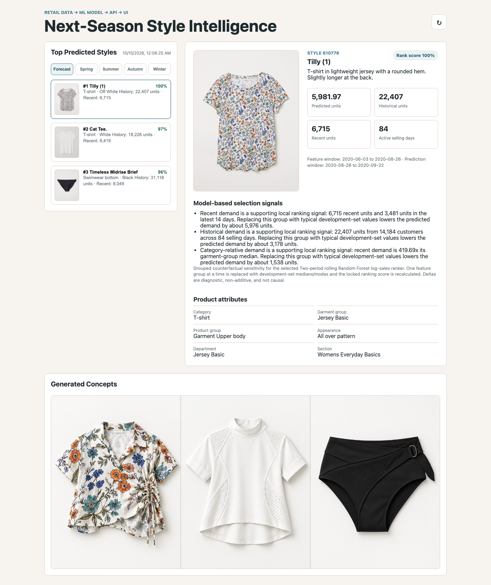
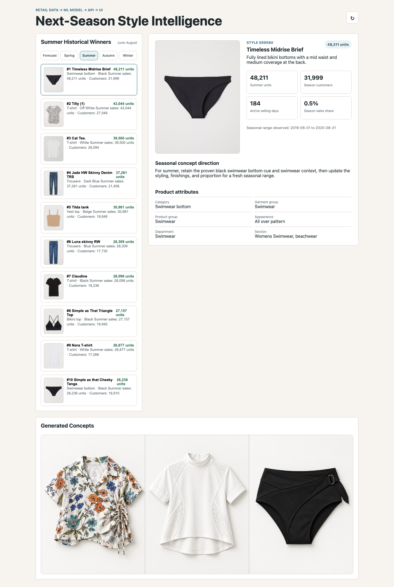
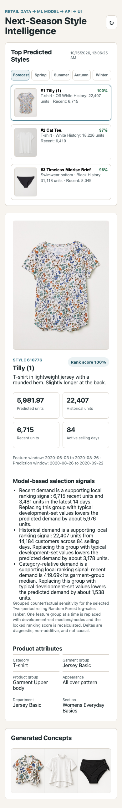

# Next-Season Style Intelligence Platform

End-to-end solution for the Full Stack Data Scientist assignment:

`Retail Data -> ML Model -> Prediction Output -> Backend API -> Frontend -> Business User`

The project predicts the three H&M styles most likely to perform strongly in a future period, prepares concept-generation briefs from those styles, and serves the results through a backend and UI.

For the final results, limitations, and recommended demo sequence, see [SUBMISSION_NOTES.md](SUBMISSION_NOTES.md).

## App Screenshots

### Forecast And Generated Concepts



### Summer Historical Winners



### Mobile Forecast View



## Repository Structure

```text
data_science/
  eda.py
  features/build_features.py
  train.py
  predict.py
  generate_concepts.py
backend/
  api.py
  model_service.py
frontend/
  index.html
  styles.css
  app.js
models/
outputs/
docs/
  API.md
  PROJECT_EXPLANATION.md
  screenshots/
SUBMISSION_NOTES.md
run_pipeline.py
requirements.txt
```

## Data Setup

The official Kaggle files are large and are not committed to this repository. Place them here:

```text
data/raw/transactions_train.csv
data/raw/articles.csv
data/raw/images/<article-id-prefix>/<article-id>.jpg
```

If Kaggle CLI is available and authenticated:

```bash
python -m data_science.data_acquisition --download
```

If not, manually download the H&M Personalized Fashion Recommendations data from Kaggle, unzip it, and copy the CSVs plus image folders into `data/raw/`.

For local development, symlinks are fine and avoid duplicating the 3.2 GB transaction file:

```bash
mkdir -p data/raw
ln -sf /path/to/articles.csv data/raw/articles.csv
ln -sf /path/to/transactions_train.csv data/raw/transactions_train.csv
```

## Run Pipeline

Install dependencies:

```bash
python3 -m pip install -r requirements.txt
```

Run the full pipeline:

```bash
python3 run_pipeline.py
```

For a quick local smoke test on a recent subset:

```bash
python3 run_pipeline.py --max-transactions 8000000
```

The capped run intentionally uses the latest rows, not the oldest rows, because the modeling pipeline needs enough date coverage for eight development snapshots plus the final holdout. Smaller samples may fail with a clear date-coverage message.

Pipeline outputs:

```text
outputs/eda_summary.md
outputs/eda_summary.json
outputs/eda_plots/
outputs/model_metrics.json
outputs/model_feature_importance.json
outputs/style_explanations.md
outputs/style_predictions.csv
outputs/top_styles.json
outputs/seasonal_styles.json
outputs/concept_briefs.json
outputs/generated_concepts.png
outputs/generated_concepts_fallback.png
models/style_winner_model.joblib
```

The submitted model artifact contains the selected deployable pipeline rather than every rejected experimental model, keeping it practical to share. The metrics artifact retains the complete candidate comparison.

## EDA Result

The submitted EDA covers all 31,788,324 transaction rows and reports sales trends, customer frequency, product/category concentration, calendar seasonality, and data quality. Key findings include a 90.3% repeat-customer share, 30.2% of sales rows concentrated in the top 1% of styles, and the highest average daily volume in June/Summer.

See `outputs/eda_summary.md`, `outputs/eda_summary.json`, and the five charts under `outputs/eda_plots/`.

## Backend

Start the API:

```bash
python3 -m backend.api
```

Required endpoints:

```text
GET /styles/top
GET /styles/{style_id}
```

Useful endpoints:

```text
GET /health
GET /seasons
GET /styles/season/{season}
POST /admin/refresh
```

Full endpoint contracts, response-field semantics, error examples, and cache behavior are documented in [docs/API.md](docs/API.md). Interactive Swagger documentation is available at `http://127.0.0.1:8000/docs` and OpenAPI JSON at `http://127.0.0.1:8000/openapi.json` after installing the declared dependencies.

The API returns a clear `503` if the prediction artifacts have not been generated, and a clear `404` for an unknown `style_id`.

## Frontend

After the API is running, open:

```text
http://127.0.0.1:8000/app/
```

The UI shows:

- ranked top predicted styles
- seasonal historical winners for Spring, Summer, Autumn, and Winter
- prediction score
- image where available
- product attributes
- historical sales and recent sales
- model reasoning

## Public Deployment

The repository includes a Render Blueprint in `render.yaml`. It deploys the FastAPI backend and
frontend as one free web service, uses the committed prediction artifacts, and packages only the
catalogue images needed by the submitted forecast and seasonal views.

1. Push this repository to GitHub.
2. In Render, choose **New > Blueprint** and connect the repository.
3. Confirm the `merchmix-style-intelligence` free web service and deploy it.
4. Open the assigned `https://<service-name>.onrender.com/` URL.

The root URL redirects to the frontend. API documentation is available at `/docs`, and `/health`
confirms that the submitted model, predictions, concept board, and seasonal artifacts are present.

The free service may spin down after inactivity, so open the public URL shortly before a live
walkthrough. No raw H&M data or environment secrets are needed at runtime because the final
prediction artifacts are already committed.

## Concept Generation

`data_science/generate_concepts.py` creates structured concept briefs and a polished deterministic concept board linking each predicted style to a new product concept:

```text
outputs/concept_briefs.json
outputs/generated_concepts_fallback.png
```

The final submission image is generated with AI from the three selected style reference images and saved as:

```text
outputs/generated_concepts.png
```

The final board deliberately evolves silhouette and construction for a stronger new-concept signal. The conservative first pass is retained at `outputs/generated_concepts_conservative.png`, and the final board is also preserved at `outputs/generated_concepts_adventurous.png`.

The generation trace, source image paths, and prompt are documented in:

```text
outputs/ai_concept_generation.md
```

The trace and `outputs/concept_briefs.json` explicitly connect each predicted style and its model-backed success signals to the final named concept and meaningful design changes.

## Model Result

The final model is a two-period rolling `RandomForestRegressor` trained on `log1p(target_units)`. It was selected from six expanding-time validation folds, not one validation month. The comparison includes an expanding regression, a top-decile classifier, and a blended ranker. Selection rewards mean Precision@3 and Precision@10 while penalizing fold variance.

Features include explicit prediction month/season, category-normalized momentum, observed launch age, and 14-day demand acceleration alongside demand, recency, price, and product attributes.

Winner explanations use grouped counterfactual model sensitivity, supported by a separate global feature-importance artifact. The deltas show how the fitted prediction changes when a signal group is replaced with training medians/modes; they are diagnostic, non-additive, and not causal.

Rolling-development results, averaged across six folds:

| Metric | Selected model | Recent-sales baseline |
| --- | ---: | ---: |
| MAE | **46.83** | 49.15 |
| RMSE | 179.32 | **174.19** |
| Precision@3 | 0.667 ± 0.000 | 0.667 ± 0.000 |
| Precision@10 | **0.683 ± 0.069** | 0.650 ± 0.096 |

On the untouched final holdout, the model improves MAE/RMSE (`43.36/199.40` versus `64.32/229.01`) but ties the baseline on ranking (`P@3 0.0`, `P@10 0.2`). This is reported rather than hidden and is discussed as temporal regime risk.

The predicted styles finished at actual holdout ranks 12, 22, and 136. The true top three were predicted at ranks 8, 4, and 18. The concrete error analysis, missing-data explanation, and production corrections are documented in [SUBMISSION_NOTES.md](SUBMISSION_NOTES.md#final-holdout-diagnosis).

The current business target is next-28-day unit sales because that is what the supplied data supports. A production ranking should combine the demand forecast with availability, margin, lifecycle, uncertainty and assortment constraints after stakeholders agree on what “winner” means. See [Business Definition Used and How It Could Evolve](docs/PROJECT_EXPLANATION.md#business-definition-used-and-how-it-could-evolve).

Final full-data top three: `610776` Tilly (1), `717490` Cat Tee., and `599580` Timeless Midrise Brief. Full values and interpretation are in [SUBMISSION_NOTES.md](SUBMISSION_NOTES.md).

## Notes

The dataset does not include reliable stock-on-hand or availability history. The model predicts observed future sales performance, not pure latent demand. This limitation is discussed in detail in `docs/PROJECT_EXPLANATION.md`.
